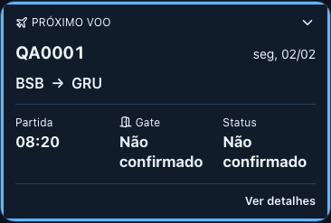
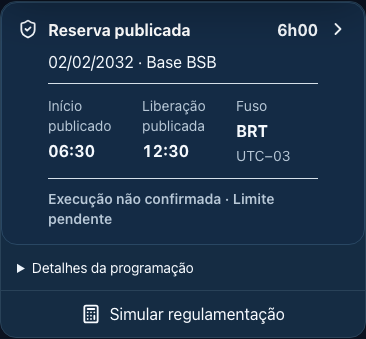
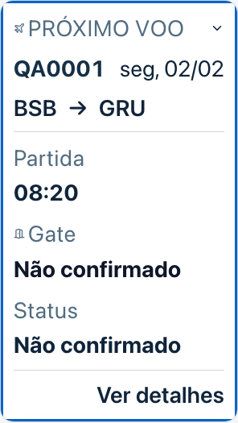
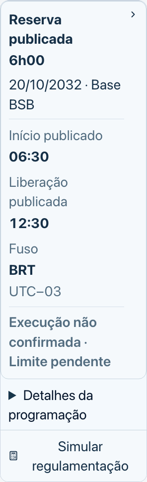
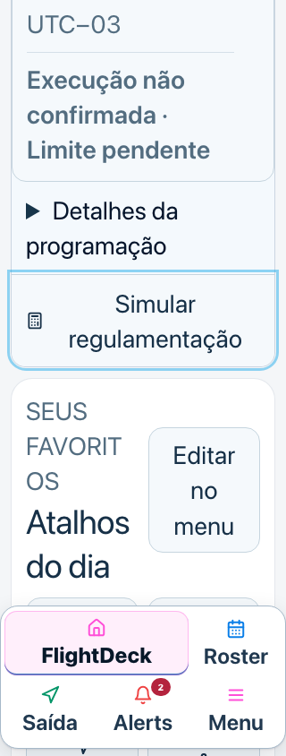

# Home: próximo voo e reserva — revisão de apresentação

Base: `6269b5100a5db25fbcd90696747cd95829221795` (main confirmado pelo conector GitHub em 22/10/2026).

## Escopo e ownership

Checkout isolado criado a partir dos objetos locais do mesmo remoto `bmedeiros1987/crewcheck`, sem copiar alterações não commitadas. Nenhum AGENTS.md ou CODEOWNERS foi encontrado nos caminhos aplicáveis/arquivos rastreados. Foram conferidas as listas completas de arquivos dos 83 PRs abertos: apenas #1032 sobrepõe os arquivos de próximo voo; ela é a composição de evidência explicitamente marcada NÃO INTEGRAR, com a versão histórica inteira adicionada ao diff. Não é evidência de um owner Visual Guard ativo. #1198 (Radar), #919 (footer), #1200 (financeiro) e #1201 (segurança) não sobrepõem os quatro arquivos alterados. Não há mudança em Home.tsx, motores, horários, identidade, seleção, manifests, gates ou workflows.

A referência privada 118653.jpg foi materializada pela Library no próprio executor e seus pixels foram inspecionados antes da implementação. A referência real não faz parte deste commit nem do PR. Todas as imagens abaixo e todos os testes usam apenas fixtures sintéticas.

## Comportamento

- Próximo voo: identidade/data e rota acima da grade Partida/Portão/Status. Portão e status ausentes continuam independentes. A ausência não repete duas explicações adicionais de não confirmação. Fonte manual, desatualização, conflitos e vínculo pendente permanecem visíveis; autoria e proveniência completas ficam nos detalhes, acessíveis por teclado.
- Reserva/jornada: título e duração, data/base e grade de início/liberação/fuso. Execução não confirmada e limite pendente continuam visíveis. Programação e motivos completos ficam em details nativo. A calculadora usa uma linha de ação de largura integral abaixo do conteúdo, com o mesmo onOpen.
- A semântica exportada de gateSourceLabel, openCanonicalDutyDetails, onOpen e os estilos cc-manual-gate/cc-gate-review permanecem preservados. Nenhum amarelo/âmbar foi introduzido.

## Validação e limites

- npm run check (preparação canônica e TypeScript) e npm run build (build canônico, ativos OCR públicos fixados/verificados).
- regression-canonical-duty-card-browser.mjs: seis casos de componente, temas, identidade de navegação e estado incompleto. A asserção de frase única foi substituída por asserções dos campos separados da grade; a programação continua obrigatória nos detalhes.
- regression-canonical-duty-home-browser.cjs: Home real compilada, 320/360/390/1440, claro/escuro e alteração real pelo Settings100/200%. São 16 combinações para jornada/Próximo voo e outras16 para reserva. As APIs são interceptadas. Jornada incompleta continua pendente.
- regression-home-flight-duty-layout-browser.mjs:128 combinações de largura/tema/tamanho/estado usando cards, hooks e storage reais com CSS de produção. Portão/status independentes, manual/divergência, conflito, stale, vínculo pendente e reserva incompleta. Enter/Space/Tab, foco visível, alvos mínimos, largura disponível da grade e medição de clipping por caractere.32 screenshots sintéticos.
- regression-next-flight-gate.mjs; regression-next-flight-gate-prepared.mjs; regression-next-flight-gate-pulse-browser.mjs; regression-manual-gate-review-browser.mjs; regression-v14-3-86-flydeck-duty-limit.mjs.
- Revisão local de diff: sem alterações de motor/seleção/identidade; função exportada e bloco CSS manual comparados com a base. A inspeção visual encontrou o estreitamento causado pela cascata global de botão; o grid agora define sua coluna e alongamento explicitamente e o teste mede a largura real.

A fonte200% permite crescimento vertical sem cortar texto. Não houve validação em aparelho físico, merge, deploy, uso de dados reais, serviços pagos ou alteração de credenciais/permissões. O teste de quick-roster que substitui NextFlight por null não é usado como prova deste card.

## Evidência visual sintética

## Achado da revisão independente: contraste e prova de acesso

O reviewer encontrou baixo contraste nos novos detalhes em320px/claro/200%. Confirmado: o wrapper usava a variável genérica de superfície e os detalhes herdavam fundo escuro com texto escuro no tema claro. A correção mantém superfície, texto e marcador próprios por tema no escopo de cc-canonical-duty-tools. O footer não foi alterado.

Medição na Home compilada,320px/200%:

| Tema | Fundo dos detalhes | Texto | Contraste texto/marcador/motivos/calculadora |
| --- | --- | --- | --- |
| Claro | rgb(244,249,253) | rgb(6,22,44) |17.10 /12.05 /5.12 /12.80 |
| Escuro | rgb(21,44,67) | rgb(248,251,255) |13.73 /12.85 /13.73 /13.73 |

O helper scripts/fixtures/duty-card-visual-checks.cjs exige4.5:1 para texto/motivos/calculadora e3:1 para marcador. As duas suítes de layout exercitam o helper nos dois temas e tamanhos100/200%. A suíte da Home também usa elementFromPoint para verificar que os controles focados não estão cobertos. Em320px/200%, após rolagem, a calculadora ocupa y305.625–409px e o footer começa em676px; foco3px, alvo103.375px, sem obstrução. Enter/Space/Tab continuam testados.

A imagem de reserva320px/200% acima mostra agora o card completo em fixture isolada com CSS de produção, evitando tratar um recorte coberto pelo footer como prova de visibilidade. A prova adicional abaixo vem da Home real, com Settings200%, após rolagem até a ação:

Revalidação local após o achado: TypeScript e build canônicos PASS;6 casos do componente,32 combinações da Home e128 casos de layout/estado PASS. O candidato foi revalidado localmente e autorizado para atualização da mesma draft, sem force. Revisão independente do novo diff remoto permanece pendente; não é aprovação integral.

CI do HEAD publicado a6d3ff2daa8465478af43735e4c0659b80162184: o gate Web falhou no npm audit por DOMPurify<=3.4.16 herdado de main; a correção pertence à#1201 e permanece preservada. No HEAD inicial,15 workflows passaram,1 foi pulado e o Web falhou no audit. A atualização da draft foi autorizada; a CI do novo HEAD deve ser conferida separadamente. Não houve merge/deploy nem alteração de gates.

Revalidação antes da atualização da draft: main e a ref da PR permaneceram em6269b510 e a6d3ff2d. As listas reais de arquivos dos84 outros PRs abertos foram novamente conferidas; apenas a composição histórica#1032 sobrepõe estes paths. Nenhum arquivo de CrewCierge,#1198,#919,#1200 ou#1201 foi alterado.
